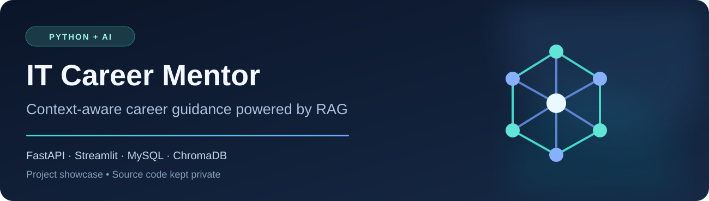
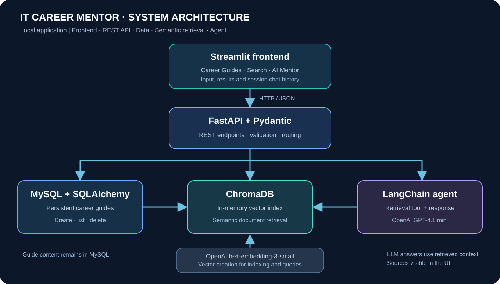

  

<h1 align="center">IT Career Mentor — AI-Powered Career Guidance</h1>

  <strong>A practical Python &amp; Agentic AI portfolio project</strong> 
  FastAPI · Streamlit · MySQL · SQLAlchemy · ChromaDB · LangChain · OpenAI · RAG

  <a href="#project-overview">Overview</a> ·
  <a href="#key-capabilities">Features</a> ·
  <a href="#system-architecture">Architecture</a> ·
  <a href="#how-rag-works">RAG workflow</a> ·
  <a href="docs/CASE_STUDY.md">Case study</a> ·
  <a href="docs/DEMO_WALKTHROUGH.md">Demo walkthrough</a>

> **Portfolio showcase — source code is private.** This public repository documents the application's functionality, system design, technical decisions and lessons learned. The full application is available for a live technical walkthrough upon request. This is a locally tested educational project, not a public SaaS product or a production deployment.

## Project overview

**IT Career Mentor** is an AI-assisted application designed to help people exploring careers in technology navigate topics such as CV preparation, technical interviews, GitHub portfolios, LinkedIn networking and career progression.

Instead of relying on a generic chatbot, the application combines **structured career guides**, **semantic document retrieval** and an **AI agent** that uses the retrieved material as context when answering questions.

I built this project as the final assignment of my **Python & Agentic AI training**, applying backend development, data persistence, API integration and retrieval-augmented generation (RAG) in one working application.

### Project at a glance

| | |
| --- | --- |
| **Type** | Educational, locally run full-stack AI application |
| **My contribution** | Designed and integrated the Python backend, Streamlit UI, database, semantic search and AI-agent workflow as a course project |
| **Content** | Eight starter career guides in English, with support for adding and deleting guides |
| **Backend** | REST API built with FastAPI and Pydantic |
| **Persistent storage** | MySQL using SQLAlchemy |
| **Semantic retrieval** | ChromaDB + OpenAI `text-embedding-3-small` |
| **AI assistant** | LangChain agent with OpenAI `gpt-4.1-mini` |
| **Status** | Running locally; available for a guided demonstration |

## Key capabilities

| Capability | What it does |
| --- | --- |
| **Career Guides** | Browse eight initial guides and filter them by category. |
| **Add a Guide** | Create a guide with input validation and duplicate-title checking. |
| **Delete a Guide** | Remove a guide from MySQL and the semantic-search index. |
| **Semantic Search** | Retrieve contextually related career guides using vector embeddings and display retrieval distances. |
| **AI Mentor** | Ask natural-language career questions and receive contextual answers based on retrieved material. |
| **Source visibility** | Inspect the guide content returned to the AI agent as a source. |
| **Conversation continuity** | Continue a conversation within the active Streamlit session. |

### Career topics included

`Resumes` · `GitHub portfolios` · `LinkedIn networking` · `Behavioral interviews` · `Technical interviews` · `Salary negotiation` · `IT career paths` · `First 90 days at a new job`

## System architecture

  

**Separation of concerns:** the Streamlit frontend handles interaction, FastAPI exposes REST endpoints, MySQL stores guide records, ChromaDB handles semantic similarity, and the LangChain agent orchestrates retrieval and answer generation.

For implementation decisions, limitations and trade-offs, see the [technical case study](docs/CASE_STUDY.md).

## How RAG works

**RAG — Retrieval-Augmented Generation** — augments an LLM response with content retrieved from a relevant knowledge collection.

1. **Prepare knowledge:** initial guides are saved in MySQL; their text is indexed into ChromaDB using `text-embedding-3-small`.
2. **Receive a question:** the user asks about an IT career topic through the Streamlit interface.
3. **Retrieve context:** the backend or agent queries the vector index for semantically related guides.
4. **Generate an answer:** the LangChain agent uses `gpt-4.1-mini` and a retrieval tool to formulate an answer informed by the returned guides.
5. **Expose sources:** the app shows the retrieved guide material, helping users inspect what informed the response.

> Retrieval makes answers more grounded in the supplied material, **but does not guarantee factual correctness**. The current implementation uses the nearest matches without a minimum similarity threshold.

## Technologies and responsibilities

| Layer | Tools | Role |
| --- | --- | --- |
| Language | Python | Application logic and integration |
| Frontend | Streamlit | Multipage user interface and chat interaction |
| Backend | FastAPI, Uvicorn | HTTP endpoints for guides, search and chat |
| Validation | Pydantic | Request and response schemas |
| Database | MySQL, SQLAlchemy, PyMySQL | Persistent guide records |
| Vector search | ChromaDB | In-memory semantic index and nearest-neighbor retrieval |
| Embeddings | OpenAI `text-embedding-3-small` | Convert text into semantic vectors |
| AI orchestration | LangChain | Agent and tool-based guide retrieval |
| LLM | OpenAI `gpt-4.1-mini` | Generate context-aware responses |
| Client/API integration | Requests | Connect Streamlit to FastAPI |

## A look at the user experience

**Example scenario:** A user asks, “How can I prepare for my first junior Python developer interview?”

- **Career Guides:** select *Interviews* to browse relevant reference material.
- **Semantic Search:** enter a natural-language question and inspect which guides are retrieved.
- **AI Mentor:** ask a question, review the answer, expand the sources and ask a follow-up.
- **Guide Management:** add a test guide, confirm it becomes searchable and then delete it.

A [step-by-step demo script](docs/DEMO_WALKTHROUGH.md) shows how I present the application during a technical interview. Real application screenshots can be added later following the [visuals guide](docs/SCREENSHOTS_GUIDE.md); no synthetic UI screenshots are used in this repository.

## Engineering challenges and lessons learned

- **Connecting multiple components:** traced requests from Streamlit through FastAPI and into persistence, retrieval and AI services.
- **Database configuration:** worked with SQLAlchemy/MySQL connections, runtime environment variables and initialization of guide records.
- **Retrieval behavior:** learned why vector distance is not the same as answer confidence, and why source inspection matters.
- **Data consistency:** handled adding and deleting records across the database and semantic index, while recognizing failure cases requiring stronger coordination.
- **Debugging external integrations:** investigated authentication, network and API configuration errors during local testing.

## Current scope and limitations

- The application is intended for **local demonstration and learning**, not public production hosting.
- There is **no user authentication or authorization** layer.
- ChromaDB runs **in memory**; the index is rebuilt from MySQL on backend restart, potentially requiring fresh embedding calls.
- Chat history is retained **only within the current Streamlit session**.
- The database and vector index are updated separately; an interrupted operation can temporarily leave them inconsistent.
- The app does not include a comprehensive automated test suite or a hosted live demo.

These limitations also suggest clear next steps: persistent vector storage, automated API tests, more robust synchronization and deployment hardening.

## Explore more

- [**Technical case study:** architecture, data flow and design trade-offs](docs/CASE_STUDY.md)
- [**Live-demo walkthrough:** five-minute interview presentation](docs/DEMO_WALKTHROUGH.md)
- [**Screenshot guide:** how to add authentic application images](docs/SCREENSHOTS_GUIDE.md)

## About the developer

**Constantin Ionescu** · Aspiring Python / Backend Developer

I completed Python & Agentic AI training while working in a structured, international environment at Bosch. My interests include Python backend development, automation and AI-powered applications. I also speak fluent German.

- **LinkedIn:** [linkedin.com/in/ionescu-constantin-it-tech](https://www.linkedin.com/in/ionescu-constantin-it-tech/)
- **GitHub:** [github.com/ittechconstantin](https://github.com/ittechconstantin)
- **Technical review:** a guided demonstration of the private source code can be arranged upon request.

---

© 2026 Constantin Ionescu. Portfolio documentation and diagrams are shared for viewing; no software source-code license is granted here. This repository does not include the private application implementation.
