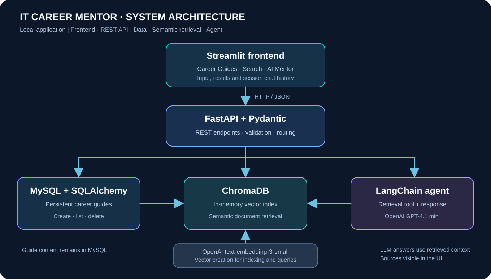

# Technical Case Study — IT Career Mentor

**Project:** AI-powered IT career guidance using retrieval-augmented generation (RAG)  
**Author:** Constantin Ionescu  
**Context:** Final project for completed Python & Agentic AI training  
**Environment:** Local educational application; not publicly deployed

[← Back to the portfolio](../README.md)

## 1. The problem

People transitioning into software development often have related questions across several topics: how to write a technical CV, how to prepare for interviews, how to organize a GitHub portfolio, and what to expect in a first role.

A generic language model can provide answers, but its response may not be linked to a known set of reference materials. This project explores a different approach: keep curated guides as structured knowledge, retrieve the guides relevant to a question, and make the underlying sources inspectable.

## 2. Solution design

I created a multipage application with four main user journeys:

| Journey | Behavior |
| --- | --- |
| Browse | Display a set of categorized IT career guides |
| Manage | Add validated guides and remove obsolete guides |
| Search | Find related guides using embeddings and vector similarity |
| Ask | Use an AI mentor that accesses guide content through a retrieval tool |

The application deliberately separates the user-facing UI, API layer, persistent database, semantic retrieval and AI orchestration.

## 3. Technical architecture

### Interface — Streamlit

The frontend provides separate views for Career Guides, Add a Guide, Semantic Search and AI Mentor. It communicates with the backend over HTTP and keeps the active chat session history in Streamlit session state.

### REST API — FastAPI and Pydantic

FastAPI exposes endpoints for listing, creating and deleting guides, performing semantic search and interacting with the AI mentor. Pydantic validates structured request data and defines response formats. Note that the original application retains some Romanian route names and JSON keys internally to maintain compatibility with the initial course project; the current user-facing edition is in English.

### Storage — MySQL and SQLAlchemy

MySQL stores guide records containing a title, category, content and date. SQLAlchemy manages database models and sessions. On initialization, starter guides are loaded if the relevant table is empty. Stored records provide the durable source from which the semantic index is rebuilt.

### Retrieval — ChromaDB and OpenAI embeddings

Guide content is embedded using `text-embedding-3-small` and indexed in an in-memory ChromaDB collection. A search produces the closest documents plus metadata and vector distances. Lower distance means closer semantic matching under the configured distance metric; it does **not** represent a probability of correctness.

### AI agent — LangChain and OpenAI

A LangChain agent uses `gpt-4.1-mini` and a guide-retrieval tool. The agent is instructed to rely on retrieved guides for career advice, cite guide titles and acknowledge when the material does not cover a question. The app can display the tool-returned source text so users can inspect that context.

## 4. End-to-end examples

### A. Asking a career question

1. User sends an interview-preparation question through Streamlit.
2. Frontend sends an HTTP request to the FastAPI chat endpoint.
3. LangChain receives the user's message and available in-session conversation history.
4. The agent can call the retrieval tool with a semantic query.
5. ChromaDB returns related guide passages using OpenAI-generated embeddings.
6. The model formulates an answer based on the retrieved guide material.
7. The frontend displays the answer and can reveal the retrieved sources.

### B. Adding a guide

1. User fills out a guide form and submits its title, category and content.
2. FastAPI validates the request with Pydantic.
3. The backend checks whether the title already exists.
4. A new guide is committed to MySQL.
5. The guide is added to the ChromaDB index for future searches.
6. The frontend can display the new guide and return it in subsequent searches.

### C. Deleting a guide

1. User selects a guide to remove.
2. Backend removes the persistent record from MySQL.
3. The corresponding entry is removed from the in-memory vector index.
4. Subsequent guide listings and searches reflect the removal.

## 5. What I implemented and practiced

- Object-oriented Python and application modularization
- API endpoints, request validation and JSON communication
- Database models, sessions and CRUD-oriented operations
- Natural-language semantic search using text embeddings
- Retrieval tool integration with an LLM agent
- Multipage Streamlit navigation and session-based conversations
- Environment-based API credentials and local configuration
- Debugging and integration across multiple services

This demonstrates **project-based learning and hands-on integration**, not paid production engineering experience.

## 6. Design decisions and trade-offs

| Decision | Benefit | Limitation |
| --- | --- | --- |
| Streamlit as UI | Fast prototyping with Python | Less frontend flexibility than a custom SPA |
| FastAPI as a separate service | Clear API boundary and validation | Two processes must run locally |
| MySQL as persistent store | Guides survive application restart | Requires a configured database instance |
| In-memory ChromaDB | Simple educational setup | Index rebuild and embedding calls at restart |
| Nearest-neighbor retrieval | Easy to inspect semantic matches | No minimum relevance threshold |
| LangChain agent + retrieval tool | Demonstrates tool use and grounding | Responses can still be incomplete or incorrect |
| In-session chat state | Supports follow-up questions easily | Conversations are lost when the session ends |

## 7. Challenges encountered

**Getting the full stack running.** Coordinating Python packages, database connection settings, API credentials and network requests taught me to debug each layer independently rather than treating the app as one black box.

**Understanding source grounding.** Building semantic search and inspecting returned passages helped me distinguish retrieval quality from the fluency of generated answers.

**Synchronizing two stores.** Guide content exists in MySQL and in a vector index. This works in the current local workflow, but it also exposed the need for transactions, reconciliation or retry logic in more demanding systems.

## 8. What I would improve next

1. Add `pytest`-based unit and integration tests for API validation, guide CRUD and retrieval behavior.
2. Add persistent vector storage to avoid full index rebuilding on each process restart.
3. Improve resilience when an embedding request fails after a MySQL commit.
4. Add retrieval filtering / relevance thresholds and measure answer quality on a defined evaluation set.
5. Introduce authentication, authorization, rate limiting, structured logging and secret management before any public deployment.
6. Pin dependency versions and add CI for repeatable installs.

## 9. Access and technical review

The full application code is intentionally private. This public case study explains the architecture and implemented capabilities without publishing the internal Python modules. A live local demonstration or source walkthrough can be arranged for recruiters and interviewers upon request.

[← Back to the portfolio](../README.md)
